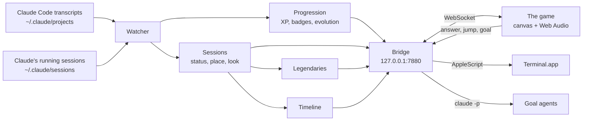

# Pokémon Agents

**Your coding agents, live, as Pokémon.**

*A non-commercial fan project inspired by the Pokémon games. Not affiliated with or endorsed by
Nintendo, Game Freak, Creatures or The Pokémon Company; see the [disclaimer](#disclaimer).*

When you have a lot of Claude Code sessions open at once, the hard part is knowing which one needs
you. Pokémon Agents turns each session into a Pokémon in a Pokémon Crystal-style Violet City. You
can see at a glance who is working, who finished, and who is waiting on a decision: that one walks
up to you with a `!` and the Pokégear rings.

Each project is one Pokémon, rolled the first time that project appears and kept for good. It levels
up, earns badges and evolves through the real Gen 1 and 2 tree, driven by what your sessions
actually did: commits, merges, green test runs, fixes.

It works with Claude Code in the terminal and with the Claude desktop app. From inside the game you
can answer a waiting session, jump to its terminal, start an agent on a goal, and look back at
everything that happened while you were away.

## See it

`npm run demo` records a short demo from a made-up world — five invented projects at work, a goal
that asks a question and gets answered on screen, an evolution, and the timeline of it all — and
writes it to `artifacts/demo/`. Nothing in it is real: it uses its own temp transcripts, an empty
session registry and a stand-in for `claude`, so it never shows your own sessions.

The recording is not kept in this repository, because it is a screen capture of Nintendo's artwork
and this project does not redistribute that. Run it and the copy is yours, on your own machine.
It needs `ffmpeg`.

## Run it (about two minutes)

You will need macOS, Node 22 and Claude Code. Answering and terminal jumps use Terminal.app; the
rest works anywhere.

```bash
npm install
npm run setup   # once: enables the git hooks and fetches the Pokémon assets into .cache/
npm start       # then open http://127.0.0.1:7880
```

The first start reads your whole Claude history once (about 20 seconds for 4.6 GB) and then only
follows what is new. Progress is kept in `~/.pokemon-agents/`. The game is silent until your first
key press or click, because browsers block sound until then.

<details>
<summary><b>Keep it running (and start it at login)</b></summary>

`npm start` stops when its terminal closes. To keep the bridge running and start it at login, save
this as `~/Library/LaunchAgents/com.you.pokemon-agents.plist`, fill in your paths, and load it:

```xml
<?xml version="1.0" encoding="UTF-8"?>
<!DOCTYPE plist PUBLIC "-//Apple//DTD PLIST 1.0//EN" "http://www.apple.com/DTDs/PropertyList-1.0.dtd">
<plist version="1.0"><dict>
  <key>Label</key><string>com.you.pokemon-agents</string>
  <key>ProgramArguments</key><array><string>/path/to/node</string><string>src/server.mjs</string></array>
  <key>WorkingDirectory</key><string>/path/to/pokemon-agents</string>
  <key>EnvironmentVariables</key><dict>
    <key>PATH</key><string><!-- your shell's $PATH, so goals can find git, node and gh --></string>
    <key>CLAUDE_BIN</key><string><!-- the output of: command -v claude --></string>
  </dict>
  <key>RunAtLoad</key><true/>
  <key>KeepAlive</key><true/>
  <key>StandardOutPath</key><string>/Users/you/.pokemon-agents/bridge.log</string>
  <key>StandardErrorPath</key><string>/Users/you/.pokemon-agents/bridge.log</string>
</dict></plist>
```

```bash
launchctl bootstrap gui/$(id -u) ~/Library/LaunchAgents/com.you.pokemon-agents.plist
launchctl kickstart -k gui/$(id -u)/com.you.pokemon-agents   # restart after changing src/
```

Changes under `web/` only need a page reload.
</details>

<details>
<summary><b>Stuck?</b></summary>

- **"Pokémon assets missing"** on start: run `npm run setup`. It needs the network once.
- **BRIDGE OFFLINE** in the game: the bridge is not running. Start it, or look in
  `~/.pokemon-agents/bridge.log`.
- **TERMINAL or answering does nothing:** macOS asks once to let `node` control Terminal. Allow it
  in System Settings > Privacy & Security > Automation.
- **No sound:** press a key in the game first, and check it is not muted (<kbd>N</kbd>).
- **A session is missing:** sessions in temp folders (`/tmp`, `/var/folders`) and in agent
  `scratchpad` folders are ignored on purpose. Automated runs — hooks, the SDK, crons — appear only
  while they are actually working.
</details>

## Use it

Walk with the arrow keys. Press <kbd>Z</kbd> to talk to a Pokémon, <kbd>Enter</kbd> for the START
menu, and **START > HELP** explains everything from inside the game.

**Where they go.** Every building stands for a kind of work, so the map alone tells you what each
session is doing:

| What the session is doing | Where it goes |
| --- | --- |
| editing files | the house |
| reading, searching, planning | Earl's Academy |
| running tests | Violet Gym |
| git or GitHub | the Pokémon Center |
| other shell commands | the Pokémart |
| handing work to subagents | the trade house |
| web, MCP, `curl` / `ssh` | the Route 31 gate |
| a goal that finished | Sprout Tower |
| finished or idle | the park |
| waiting on you | walks up to you with a `!` |

**Statuses.** A session is **WORKING**, **NEEDS YOU** (it asked a question, opened a picker, or is
sitting on a permission prompt), **DONE** (it finished and reported), **IDLE**, or **RESTING**
(quiet for 30 minutes, back in its ball). It leaves the map when its Claude exits, or after two
quiet hours. When one project has several sessions open, the most urgent wears the project's
Pokémon and the others get different-looking stand-ins, so almost every Pokémon you see is a
different one.

**Answering.** When a session asks you something, its question comes up as soon as you are out of a
menu. Pick one of its options, or type your own:

| Where the session is running | How your answer gets there |
| --- | --- |
| a Terminal.app tab | typed into the tab, and only while Claude is in front there |
| a goal (in the background) | the session is resumed with your answer; if its run is still busy — watching CI, say — the answer waits and goes out the moment that run ends, or SEND NOW stops the run |
| the Claude desktop app | the game shows you the question and opens the app |
| a picker in a terminal | the game shows you the options and jumps to the tab |

Talking to a Pokémon also offers **SUMMARY** (what you asked, what it needs from you, the
recommended next step), **RECAP** (its last reply in full), **TERMINAL**, its **POKéMON** card and
**NEW GOAL**.

**Goals.** START > GOALS > NEW GOAL: pick a folder (in Finder, a new one under `~/code`, a typed
path, or one of your projects) and type the goal. An agent starts in the background (`claude -p`,
your default permission mode), shows up as a Pokémon, and can ask you things like any other
session. Up to four run at once; STOP ends one, and CONTINUE opens a finished goal in a new
Terminal window so you can keep talking to it.

**The timeline.** <kbd>H</kbd> opens it: everything that happened, newest first, with times, so a
sound you heard while looking away is never lost. Evolutions, badges, level-ups and new Pokémon
wait until the game is in front and focused, and then wait for <kbd>Z</kbd>. While you are away the
tab title counts what is waiting, like `(!2 ★3) Pokémon Agents`.

**Legendaries.** Badges release them, and each one has a job. It patrols its building, shows a `!`
when something wants you, and reports when you talk to it:

| Legendary | Released by | Job |
| --- | --- | --- |
| Raikou | PLAINBADGE | test watcher: live sessions whose last test run is red |
| Suicune | FOGBADGE | keeps work saved: finished sessions with uncommitted edits |
| Entei | STORMBADGE | streak keeper: warns when today has no session yet |
| Lugia | RISINGBADGE | long runs: anything working 20+ minutes, and running goals |
| Ho-Oh | all 8 badges | today's recap |
| Celebi | 30 active days | on this day: what you worked on a week and a month ago |

**Sound.** Pokémon Crystal's own sound effects: the Pokégear ring when a session needs you, the save
chime when one is done, the evolution theme and fanfare, badge and level-up jingles. <kbd>N</kbd>
turns sound on and off, and START > SOUND TEST plays each one.

| Key | Does |
| --- | --- |
| <kbd>←</kbd><kbd>↑</kbd><kbd>↓</kbd><kbd>→</kbd> | walk; hold into one of your own Pokémon to swap places with it |
| <kbd>Z</kbd> / <kbd>Space</kbd> | A: talk, pick, continue |
| <kbd>X</kbd> / <kbd>Esc</kbd> | B: back |
| <kbd>Enter</kbd> | START: sessions, timeline, map, party, PC box, trainer card, goals, sound test, help |
| <kbd>D</kbd> | the sessions that need you |
| <kbd>H</kbd> | the timeline |
| <kbd>M</kbd> | the Pokégear town map |
| <kbd>N</kbd> | sound on and off |
| <kbd>Shift</kbd> | hide the LIVE counter |

WALK TO IT, in most lists, walks you straight over to that session's Pokémon and talks to it.

## How it works

A small local server — the bridge — follows your agents' transcripts, turns them into sessions and
Pokémon progression, and pushes that to the game in your browser over a WebSocket. The game only
acts when you ask it to.



Each transcript is read from where the last pass stopped, so a restart never counts anything twice.
A session's status comes from its last turn (did it end on a question?), the tools it still has
out, and whether its Claude process is still running. Goals run detached, so they keep going if the
bridge restarts.

## Progression

The rules are all in `src/rules.mjs`.

- **XP** comes from sessions, tool calls, green test runs, commits and merges. The level is the cube
  root of XP, Gen 2's medium-fast curve.
- **Friendship** grows with active days, sessions, commits and level-ups.
- **Evolution** follows every Gen 1 and 2 rule from PokeAPI: level, friendship (with day and night
  for Espeon and Umbreon), stones from badges, trades (a session handing work to a subagent, with a
  held item where one is needed), and Tyrogue's stat rule — commits against green tests.
- **New projects** roll a base-stage Pokémon from an evolution family no other project has, so no
  two look alike. There is a 1 in 8192 shiny chance, and Eggs hatch babies.

| Badge | Earned by | Reward |
| --- | --- | --- |
| ZEPHYRBADGE | the first commit | Moon Stone |
| HIVEBADGE | 10 green test runs | Leaf Stone |
| PLAINBADGE | a failing test fixed in the same session | Thunder Stone, releases Raikou |
| FOGBADGE | the first merge | Water Stone, releases Suicune |
| STORMBADGE | a 7-day streak | Fire Stone, releases Entei |
| MINERALBADGE | 100 commits | Metal Coat |
| GLACIERBADGE | a clean session (25+ tool calls, no errors) | King's Rock |
| RISINGBADGE | 100 sessions | Dragon Scale, releases Lugia |

Achievements add a Sun Stone (10 merges), an Up-Grade (5,000 tool calls), Eggs (25 and 250
sessions), Ho-Oh (all 8 badges) and Celebi (30 active days).

## Repo map

| Path | Contents |
| --- | --- |
| `src/server.mjs` | The bridge: the HTTP and WebSocket server, and the routes for answering, jumping and goals |
| `src/transcript.mjs` | Transcript lines into progression events and live session facts. Pure |
| `src/watcher.mjs` | Follows transcripts incrementally, and decides who is on the map and what they are doing |
| `src/rules.mjs`, `progression.mjs` | XP, levels, friendship, badges, items and evolutions |
| `src/roster.mjs` | Which Pokémon each live session is drawn as |
| `src/legends.mjs` | The legendaries, their jobs and their reports |
| `src/recap.mjs` | One session's last ask, reply, question, options and next step, read on demand |
| `src/timeline.mjs` | What happened, diffed from the picture the page already gets |
| `src/terminal.mjs` | Terminal.app: jumping to a tab, typing an answer, carrying a session on |
| `src/runs.mjs`, `workspaces.mjs` | Goals: starting, resuming, queueing answers, stopping; and where one may run |
| `src/build/` | Setup-time only: the Pokédex, the city and the sounds, built from the fetched sources |
| `web/` | The game: `main.mjs` (boot, input, loop), `actors.mjs`, `city.mjs`, `screens.mjs`, `panels.mjs`, `timeline.mjs`, `widgets.mjs`, `pixels.mjs`, `audio.mjs`, `bridge.mjs` |
| `scripts/setup.mjs` | `npm run setup`: fetches the assets into `.cache/` |
| `scripts/e2e.mjs` | The end-to-end run in a real browser, against synthetic sessions and a fake `claude` |
| `test/` | Unit and bridge tests (`node --test`) |

## Common commands

```bash
npm test                # the unit and bridge tests
npm run e2e             # end to end in a browser; screenshots in artifacts/e2e/
npm run e2e -- --real   # also screenshots your real sessions, read-only
npm run demo            # records the demo from a made-up world -> artifacts/demo/ (needs ffmpeg)
node scripts/shot.mjs out.png z wait:500   # screenshot the running game after some key presses
```

The bridge takes `--port`, `--home`, `--projects` and `--sessions` (or `PKMN_PORT`, `PKMN_HOME`,
`PKMN_PROJECTS`, `PKMN_SESSIONS`), and goals use `CLAUDE_BIN`. The tests point all of them at
temporary folders, never at your real data.

## Privacy and security

Everything stays on your Mac. The bridge listens on 127.0.0.1 only, answers only its own page (it
checks the Origin and Host headers, which also blocks DNS rebinding), and never touches a repository
itself.

- **What the game shows:** session metadata — project, branch, title, status, a tool name with a
  file name or the first words of a command — all the time. A session's last ask and reply only when
  you open its SUMMARY, RECAP or ANSWER. The timeline keeps the questions and recaps of the moments
  it logs.
- **What is saved, in `~/.pokemon-agents/`:** progression, the timeline (with those questions and
  recaps), and your goals' text and logs.
- **What it acts on, and only when you ask:** an answer is typed only while Claude is the foreground
  program in that tab, at every terminal level, and a reply starting with `!` — Claude Code's shell
  mode — is refused. Goal text goes to `claude` on stdin, never as a command-line argument.

| Risk | Guardrail | Enforced by |
| --- | --- | --- |
| Another web page drives the bridge | Origin and Host checks, 127.0.0.1 only | `test/server.test.mjs` |
| Text typed into a shell instead of Claude | foreground check at every terminal level, `!` refused | `test/terminal.test.mjs` |
| Goal text read as CLI flags | stdin only | `test/runs.test.mjs` |
| A goal escaping your home folder | realpath, then one containment check | `test/workspaces.test.mjs` |
| Malicious npm install scripts | `ignore-scripts=true` in `.npmrc` | npm |
| Secrets in git | gitleaks on every commit, and over the full history in CI | `.githooks/pre-commit`, CI |
| Vulnerable dependencies | `npm audit` in CI, Dependabot, CI actions pinned to commits | CI |
| Nintendo assets in git | fetched into `.cache/` only; names, bytes and `.gitignore` all checked | `test/no-assets.test.mjs` |

## Assets

No Nintendo or Game Freak asset is committed to this repository — not one, and that is tested rather
than merely intended. `npm run setup` fetches the sprites, maps, font and sound source onto your own
machine, into the gitignored `.cache/`, from [pret/pokecrystal](https://github.com/pret/pokecrystal),
[PokeAPI/sprites](https://github.com/PokeAPI/sprites) and [PokeAPI](https://pokeapi.co), each pinned
to an exact commit. Personal use only.

`test/no-assets.test.mjs` checks three things: that no file is named like art, audio, a font, a map,
disassembly or a ROM; that no file git would take is binary at all, so renaming one does not slip it
past; and that `.gitignore` really does cover the fetched and generated trees.

## License

The code in this repository is released under the [MIT License](LICENSE).

That grant covers this project's own original code only. It does not — and cannot — license any
Nintendo, Creatures Inc., GAME FREAK inc. or Pokémon Company intellectual property. The art, font
and sound data are never redistributed here; `npm run setup` fetches them onto your own machine.
See [Assets](#assets) and the [Disclaimer](#disclaimer).

## Disclaimer

Pokémon Agents is a free, non-commercial fan project, inspired by the Pokémon games and made for
personal use. It is not affiliated with, endorsed, sponsored or approved by Nintendo, Creatures
Inc., GAME FREAK inc. or The Pokémon Company.

Pokémon and Pokémon character names are trademarks of Nintendo, Creatures Inc. and GAME FREAK inc.
The Pokémon games and all their characters, artwork, maps, fonts, music and sounds are © Nintendo,
Creatures Inc., GAME FREAK inc. and The Pokémon Company. They belong to their owners and are used
here without permission, as a fan tribute.

This repository is original code. It contains no game ROMs and no game assets of any kind. The art,
font and sound data are downloaded by `npm run setup` from public community projects
([pret/pokecrystal](https://github.com/pret/pokecrystal),
[PokeAPI/sprites](https://github.com/PokeAPI/sprites), [PokeAPI](https://pokeapi.co)) onto your own
machine, and are never redistributed by this project.

If you represent a rights holder and would like anything changed or removed, open an issue here and
it will be taken down promptly.

## Status

A personal project, used daily. What is left:

- **The Claude desktop app** cannot be started or typed into from outside, so its sessions are
  answered in the app itself.
- **macOS only** for answering and terminal jumps, which go through Terminal.app and AppleScript.
  iTerm2 is not supported yet.
